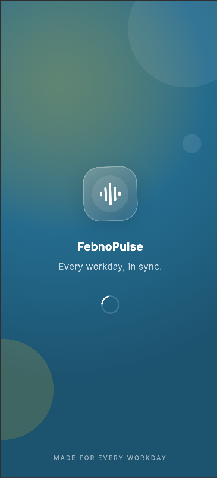
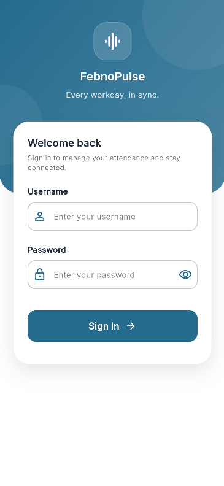
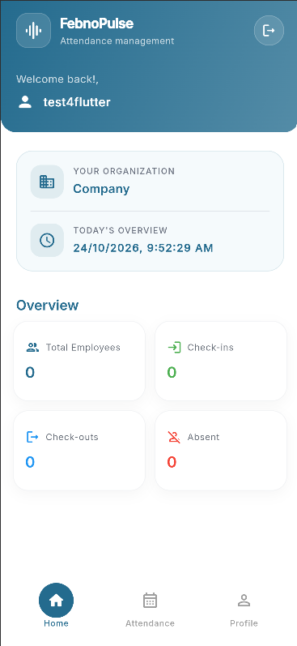
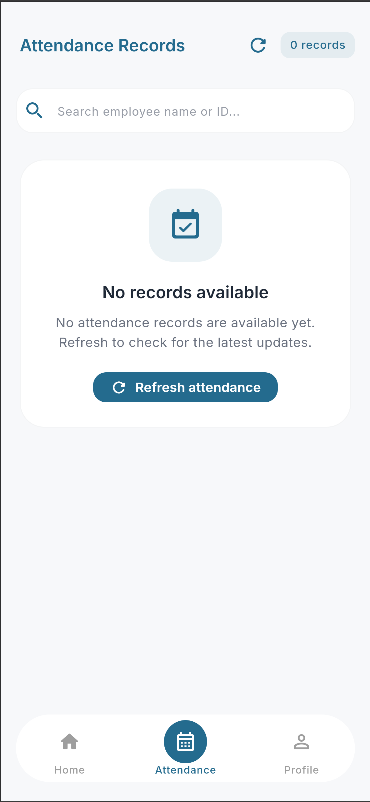
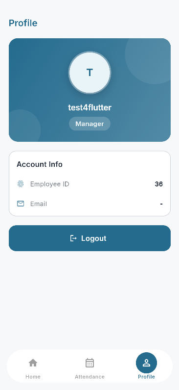

# Febno Pulse — Employee Attendance App

A Flutter-based employee attendance management application. Febno Pulse provides an interface for authorized users to view and monitor employee attendance records through a REST API.

The application includes authentication, an attendance dashboard, employee attendance records, and a profile screen.

## Features

- **Splash Screen:** Navigates to the appropriate first screen (login or home) after initialization
- **Login:** Authenticates users through the supplied authentication API.
- **Home Screen:** Provides an overview of the application.
- **Attendance Management:** Displays daily attendance records for multiple employees associated with the authenticated company account.
- **Profile:** Displays available user information.
- **API Integration:** Retrieves attendance data from the supplied backend.
- **State Management:** Uses GetX to manage application state and separate business logic from the UI.
- **Error Handling:** Provides appropriate loading, error, and empty-data states.
- **Responsive UI:** Uses Flutter widgets to provide a consistent experience across supported screen sizes.

## Screenshots

| Splash Screen | Login Screen |
|---|---|
|  |  |

| Home Screen | Attendance Screen |
|---|---|
|  |  |

| Profile Screen |
|---|
|  |


## Tech Stack

- **Framework:** Flutter
- **Language:** Dart
- **State Management:** GetX
- **Networking:** `http` 
- **Secure Storage:** `flutter_secure_storage` 

## Prerequisites

Before running the application, ensure you have:

- Flutter SDK installed
- Dart SDK compatible with your Flutter version
- Android Studio or Visual Studio Code
- An Android emulator, physical Android device, or supported target platform
- Access to the supplied backend APIs and valid test credentials

Check your installed versions:

```bash
flutter --version
dart --version
```

## Getting Started

### 1. Clone the repository

```bash
git clone https://github.com/Shazia757/febno-pulse.git
cd febno_pulse
```

### 2. Install dependencies

```bash
flutter pub get
```

### 3. Configure the API endpoints

The application uses the following API endpoints supplied for the assignment:

| Purpose | Method | Endpoint |
|---|---|---|
| Authentication | POST | `https://api-people.waslasoft.com/api/login/` |
| Attendance | GET | `https://api-people.waslasoft.com/api/transactions/` |

The login request uses a JSON body containing `username` and `password`.

The attendance request uses the access token returned by the authentication API:

```http
Authorization: Bearer <access_token>
Accept: application/json
```

No request body is specified for the attendance endpoint in the supplied assignment.

### 4. Run the application

```bash
flutter run
```

### 5. Build the Android APK

```bash
flutter build apk --release
```

The generated APK is available at:

```text
build/app/outputs/flutter-apk/Febno-pulse.apk
```

## Application Flow

1. The splash screen is displayed while the application initializes.
2. The user is directed to the login screen if authentication is required.
3. The login form validates the required fields before submitting credentials.
4. The authentication API is called using the documented request format.
5. Following successful authentication, the application processes the returned authentication data.
6. The home screen is displayed, and the attendance data is retrieved as required by the application flow.
7. The attendance screen displays daily attendance records for multiple employees.
8. Users can refresh attendance data and access the profile screen.
9. Logging out clears the locally stored authentication information and returns the user to the login screen.

## Project Structure


```text
lib/
├── main.dart
├── config/
│   ├── urls.dart
│   ├── utils.dart
│   └── theme/
│     ├── urls.dart
│     └── utils.dart
├── services/
│   └── api_service.dart
├── controllers/
│   ├── account_controller.dart
│   └── home_controller.dart
├── models/
│   ├── attendance_model.dart
│   └── user_model.dart
├── screens/
│   ├── employees_screen.dart
│   ├── home_screen.dart
│   ├── login_screen.dart
│   ├── splash_screen.dart
│   └── profile_screen.dart
└── widgets/
│   ├── custom_textfield.dart
│   ├── home_screen_widgets.dart
│   ├── navbar.dart
│   ├── summary_card.dart
```


## State Management

GetX is used to manage application state and coordinate interactions between screens and backend services.

Controllers are responsible for handling relevant application logic, including:

- Managing authentication and login loading states
- Retrieving attendance records
- Updating the UI when attendance data changes
- Managing error and empty-data states
- Coordinating profile-related state where applicable
- Handling logout and session cleanup

Reactive GetX variables and widgets are used where appropriate to update the UI when state changes.

## API Integration

### Authentication API

**Endpoint:** `POST https://api-people.waslasoft.com/api/login/`

The request sends the required username and password as JSON. The application handles the response according to the actual backend contract.

On successful authentication, the returned session or access token is processed as documented by the API. 

### Attendance API

**Endpoint:** `GET https://api-people.waslasoft.com/api/transactions/`

The request includes the bearer token obtained during authentication.

The returned response is parsed into Dart model classes, and the attendance screen presents the available employee records. Nullable or missing values should be handled gracefully.

## Error Handling

The application is designed to account for common conditions, including:

- Empty or invalid login fields
- Authentication failures
- API errors and unsuccessful HTTP responses
- Loading and empty attendance states
- Missing or nullable attendance fields
- Unauthorized responses or expired credentials, where handled by the implementation

Sensitive authentication data should not be exposed in application logs or user-facing error messages.

## Known Limitations

- Attendance information is limited to the data exposed by the supplied API.
- Available employee information and attendance fields depend on the backend response.
- User roles and permissions depend on the authenticated account and backend authorization rules.
- The application has been developed for the scope and time constraints of the technical assignment.

## Security Notes

- Use test credentials for evaluation.
- Never commit passwords, access tokens, or private configuration values.
- Store authentication tokens using an appropriate secure-storage solution if session persistence is implemented.
- Clear locally stored authentication data on logout.
- Enforce authorization through the backend rather than relying solely on client-side navigation.

## Future Improvements

Potential improvements include:

- Attendance filtering by date and employee
- Pagination for large attendance datasets
- Attendance summaries and analytics
- More detailed role-based navigation, if supported by the backend
- Automated unit and widget tests
- Improved offline and retry handling

